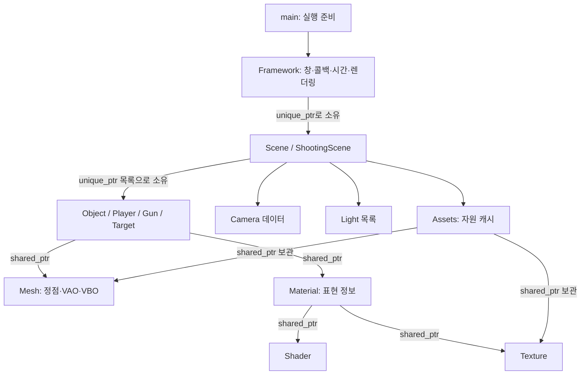
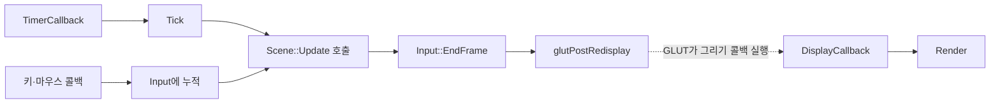
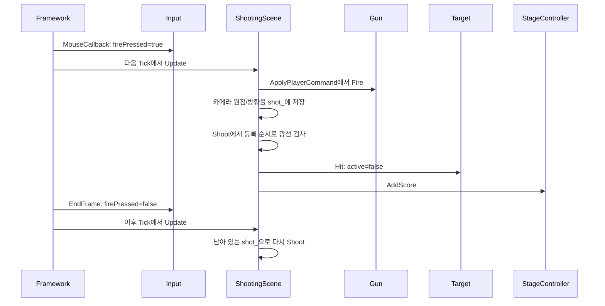

# 사격 게임 코드 분석 가이드

작성일: 2026-10-15 · 분석 기준: `474567e` (콘텐츠 복구)

이 자료는 현재 코드를 파일과 함수 단위로 읽기 위한 학습 안내서다. C++의 기본 문법을 알고 있지만
프로젝트 전체 구조와 OpenGL 실행 흐름에는 익숙하지 않은 팀원을 기준으로 작성했다.
각 절의 **읽는 순서 → 핵심 해석 → 확인 질문**을 따라가며, 질문에 자신의 말로 답할 수 있으면 다음 절로 넘어간다.

현재 코드에는 원본 게임 동작을 보존하기 위해 남겨둔 기존 문제가 있다. 따라서 이 문서의 “현재 동작”이
항상 권장 설계를 뜻하지는 않는다. 복구 이력과 검증 한계는 `HANDOFF_REFACTOR.md`의 0절을 함께 읽는다.
소스가 바뀌어도 찾기 쉽도록 줄 번호 대신 파일명과 함수명을 기준으로 안내한다.

## 1. 분석을 시작하는 방법

한 파일을 열었을 때 모든 줄을 바로 해석하려 하지 말고 다음 다섯 가지를 먼저 기록한다.

| 질문 | 기록할 내용 |
| --- | --- |
| 이 파일의 책임은 무엇인가? | 입력 수집, 이동 계산, 화면 출력 등 한 문장 |
| 누가 호출하는가? | 호출자와 호출 시점: 초기화, 업데이트, 렌더링, 종료 |
| 무엇을 읽는가? | 매개변수, 다른 객체의 상태, 파일, GPU 상태 |
| 무엇을 바꾸는가? | 멤버 값, 다른 객체, 반환값, 화면, GPU 자원 |
| 누가 수명을 관리하는가? | 소유 포인터, 관찰 포인터, 생성·해제 위치 |

권장 진행 방식은 다음과 같다.

1. **전체 흐름 훑기:** 아래 2~4절과 `main.cpp`, `Framework::Run/Tick/Render`를 읽는다.
2. **데이터 이해:** Object·Scene·Mesh·Material이 무엇을 보관하는지 확인한다.
3. **행동 추적:** 입력, 이동, 충돌, 사격, 스테이지를 하나씩 따라간다.
4. **출력 추적:** CPU의 값이 셰이더에 전달되어 픽셀이 되는 과정을 읽는다.
5. **검사와 대조:** 테스트가 어떤 동작을 기대하는지 확인하고 설명과 일치하는지 점검한다.

처음에는 `GL/`, `stb_image.h`, OBJ 파일 전체를 정독할 필요가 없다. 외부 라이브러리는 호출의 입출력과
프로젝트에서 사용하는 역할을 먼저 이해하고, 실제 구현을 조사할 필요가 생겼을 때 들어간다.

## 2. 파일을 읽는 순서

각 행을 하나의 분석 단위로 삼는다. `.h`에서 데이터와 공개 기능을 확인한 뒤 `.cpp`에서 구현을 읽는다.

| 순서 | 파일 | 이번 단계에서 설명할 수 있어야 하는 것 |
| --- | --- | --- |
| 1 | `main.cpp` | 실행 모드 선택, 실행 폴더 결정, Scene 전달 |
| 2 | `pch.h`, `pch.cpp`, `CG_Project.vcxproj` | 공통 헤더, 빌드와 링크, 자원 복사 |
| 3 | `Engine/Framework.h/.cpp` 중 Run·Tick·Render·콜백 | 이벤트 루프와 게임 코드가 만나는 위치 |
| 4 | `Engine/Object.h/.cpp` | Transform, 공유 자원, 충돌체 계산 |
| 5 | `Engine/Scene.h/.cpp` | 객체 소유와 ID, 공통 업데이트 |
| 6 | `Game/ShootingScene.h/.cpp` 중 Initialize·AddProp | 실제 게임이 어떤 데이터로 구성되는지 |
| 7 | `Engine/Input.h`, ShootingScene::Update | 물리 입력을 게임 명령으로 바꾸는 과정 |
| 8 | `Game/Player.h/.cpp`, `Engine/Camera.h/.cpp` | 이동 방향, 눈 위치, view/projection |
| 9 | `Engine/Collision.h/.cpp` | 게임 이동 판정과 광선 교차 계산의 차이 |
| 10 | `Game/Gun.h/.cpp` | 반동 시간과 최종 렌더링 행렬 |
| 11 | ShootingScene::ApplyPlayerCommand·Shoot·SpawnTarget, `Game/Target.h` | 발사, 지속 광선, 피격과 재사용 |
| 12 | `Game/StageController.h/.cpp` | 시간·점수·상태 전이와 표적 생성 요청 |
| 13 | `Engine/Assets.h/.cpp`, `Engine/Mesh.h/.cpp` | 파일 공유, 정점, CPU/GPU 버퍼 |
| 14 | `Engine/Material.h/.cpp`, `Engine/Shader.h/.cpp`, `Engine/Texture.h/.cpp` | 재질 적용, 셰이더 생성, 이미지 업로드 |
| 15 | Framework::DrawObjects·UploadLights, `Engine/Light.h/.cpp`, `Shaders/Lit.vert`, `Shaders/Lit.frag` | 변환과 조명 계산의 연결 |
| 16 | ShootingScene::GetHud, Framework::DrawOverlay·DrawColliders·CaptureFrame | HUD 내용과 표시 책임, 검사 화면 |
| 17 | `Tests/SelfTests.h/.cpp`, `Tests/RenderTests.h/.cpp` | 보존할 동작과 검증 범위 |
| 18 | `.clang-format`, `.editorconfig`, `scripts/format_code.py`, `CG_Project.vcxproj.filters` | 인코딩·정렬·프로젝트 표시 규칙 |

## 3. 전체 구조와 소유권



여기서 **포함 관계, 상속 관계, 참조 관계를 구분**해야 한다.

- `ShootingScene : public Scene`, `Player/Gun/Target : public Object`는 상속이다.
- `objects_`의 `unique_ptr`는 실제 Object의 소유권을 가진다.
- `player_`, `gun_`, `targets_`의 원시 포인터는 같은 객체를 쉽게 찾기 위한 관찰 포인터다.
- Object와 Assets의 `shared_ptr<Mesh>`는 같은 Mesh를 함께 참조할 수 있다.
- 카메라는 Player의 멤버가 아니라 Scene의 멤버다. Player가 값을 써서 연결한다.

`unique_ptr`를 `std::move`해도 관리되는 Object 자체를 다른 주소로 옮기는 것은 아니다.
따라서 `player.get()`을 저장한 후 `AddObject(std::move(player))`해도 그 관찰 포인터는 유효하다.
다만 객체를 삭제하면 관찰 포인터는 자동으로 비워지지 않는다.

**확인 질문:** 표적 하나를 비활성화하면 Sphere Mesh도 사라지는가? 같은 Material의 색을 바꾸면
그 Material을 공유하는 표적들은 어떻게 되는가? `RemoveObject()` 뒤 기존 관찰 포인터를 써도 되는가?

## 4. 시작·업데이트·렌더링·종료 경로

### 4.1 시작: main → Framework::Run

`main.cpp`는 다음 순서로 읽는다.

1. `--self-test`면 창을 만들지 않고 로직 검사를 실행한 뒤 반환한다.
2. 캡처 경로를 받았다면 작업 폴더를 바꾸기 전에 절대 경로로 만든다.
3. `GetModuleFileNameW`로 실행 파일 위치를 찾고, 자원 검색 기준을 실행 파일 폴더로 맞춘다.
4. 일반 실행은 ShootingScene, 검사 실행은 RenderTestScene을 만든다.
5. `std::move(scene)`으로 Framework에 소유권을 전달한다.

`Framework::Run`은 **GLUT 초기화 → 창/컨텍스트 생성 → GLEW 초기화 → Scene 초기화 → 콜백 등록 →
타이머 등록 → glutMainLoop** 순서다. Scene 객체를 생성하는 것과 `Initialize()`로 GPU 자원을 만드는 것은
다른 단계다. Mesh·Shader·Texture 생성에는 사용할 OpenGL 컨텍스트가 먼저 필요하다.

GLUT의 콜백은 일반 함수 형태이므로 멤버 함수의 `this`를 직접 전달하지 않는다.
정적 포인터 `Framework::current_`와 정적 콜백이 현재 인스턴스의 함수로 연결하는 통로다.
현재 코드는 실행 중인 Framework 한 개를 전제로 읽으면 된다.

### 4.2 업데이트와 렌더링은 별도 콜백이다



일반 실행에서 `Tick()`은 실제 경과 시간(초)을 구해 업데이트에 전달한다.
`1000 / 240`은 정수 연산으로 **4ms**이며, 이를 실제 240 FPS 보장이나 고정 1/240초 시뮬레이션으로
해석하면 안 된다. 콜백 예약과 처리 시간에 따라 실제 `deltaTime`이 달라진다.
업데이트 한 번과 렌더링 한 번이 항상 일대일로 실행된다고 가정하지 않는다.

검사 모드는 `deltaTime=0.1`을 전달하고 Tick에서 Render를 직접 부르는 별도 경로다.
더구나 RenderTestScene은 Update를 재정의하므로 일반 게임의 시간이 그대로 진행되는 것도 아니다.

### 4.3 종료와 자원 해제

일반 종료에서는 루프를 나온 뒤 `scene_.reset()`하고 창을 파괴한다.
창의 X 버튼 경로는 `CloseCallback()`에서 Scene를 먼저 해제한다.
Shader·Texture·Mesh의 소멸자가 `glDelete*`를 호출하므로 컨텍스트가 유효할 때 해제하는 순서가 중요하다.
Scene의 자원 캐시보다 객체 목록이 먼저 파괴되도록 멤버 선언 순서도 확인한다.

**확인 질문:** `glutMainLoop()` 다음 코드는 언제 실행되는가? `EndFrame()`을 업데이트 전에 호출하면
어떤 입력을 잃는가? 게임의 반동 시간을 Render에서 증가시키면 렌더링 횟수 차이가 어떤 영향을 주는가?

## 5. Object: 위치 데이터와 최종 표시 행렬

**읽는 순서:** Transform → Object 멤버 → GetModelMatrix → GetWorldBox → GetWorldSphere.

Transform은 위치·도 단위 회전·크기를 저장한다. GLM의 열벡터 계산을 기준으로 기본 행렬은 다음과 같다.

```text
M = T × Ry × Rx × Rz × S
worldPosition = M × localPosition
```

정점에는 오른쪽부터 S, Rz, Rx, Ry, T 순서로 작용한다. 코드에서 함수를 호출한 순서와
정점에 변환이 적용되는 순서를 구분한다. 각도를 GLM 함수에 전달할 때는 `glm::radians`로 바꾼다.

| 멤버/함수 | 해석 |
| --- | --- |
| `active` | 공통 업데이트·표시·게임 충돌 검사에서 활성 여부로 사용 |
| `visible` | DrawObjects에서 표시 여부로 사용. 업데이트 중단과는 다름 |
| `collider` | 충돌체 종류. 이것만 지정했다고 모든 충돌 검사가 자동 실행되지는 않음 |
| `blocksMovement` | Player가 이동을 막는 대상으로 선택하는 조건 |
| `GetModelMatrix()` | 렌더러가 사용할 최종 행렬. Player와 Gun에서 재정의 |
| `GetWorldBox()` | 기본 Transform으로 로컬 박스의 8개 꼭짓점을 변환한 월드 AABB |
| `GetWorldSphere()` | 로컬 크기와 스케일의 최대 축 길이 절반을 반지름으로 사용하는 구 |

AABB는 각 축의 최솟값과 최댓값으로 표현하는 박스다. 물체가 회전해도 결과 AABB 자체는 월드 축에 정렬된다.
구 충돌체는 이 게임의 구형 표적에 사용하는 표현이며 임의 메시의 정확한 표면을 나타내지는 않는다.

중요한 차이: 충돌체 계산은 가상 함수 `GetModelMatrix()`가 아닌 `transform.GetMatrix()`를 사용한다.
따라서 Player/Gun의 추가 표시 변환이 모든 충돌 계산에 자동 적용되는 구조가 아니다.
일반적인 부모·자식 Transform 트리도 없으며, 총의 부모 이동은 Gun에서 명시적으로 합성한다.

**확인 질문:** `visible=false`만 설정한 Object도 업데이트되는가? Cube의 정점 범위가 -1~1이고
scale.x가 5라면 실제 폭은 5인가, 10인가? 기본 Transform과 최종 표시 행렬은 언제 달라지는가?

## 6. Scene: 객체를 소유하는 공통 기반

**읽는 순서:** AddObject → FindObject → RemoveObject → Update → 카메라·조명·Hud 접근 함수.

`AddObject()`는 null을 거부하고, ID를 부여한 뒤 unique_ptr를 목록에 보관한다.
`FindObject()`는 ID로 선형 검색한다. ID는 벡터 인덱스와 다르며 삭제된 ID를 바로 재사용하지 않는다.
`RemoveObject()`는 소유 포인터를 지우므로 객체가 파괴된다. ShootingScene의 관찰 포인터까지 정리해 주지는 않는다.

기본 `Scene::Update()`는 활성 Object의 Update를 호출한다. 표적 생성·점수·스테이지 규칙은 여기에 없다.
실제 화면을 그리는 반복문도 Framework에 있다. Scene는 목록과 데이터를 제공하고 Framework가 그린다.

`ShootingScene::Update()`와 `Scene::Update()`는 같은 작업을 중복 호출하는 함수가 아니다.
전자는 게임의 진행 순서를 정하고, 후자는 등록된 객체의 공통 업데이트를 수행한다.
루프 중에 objects_를 추가/삭제하면 반복자가 무효화될 수 있으므로 현재 코드의 순회 규칙을 확인한다.

**확인 질문:** `unique_ptr<Object>`로 Gun을 보관해도 Gun::Update가 호출되는 이유는 무엇인가?
`objects_`의 vector가 재할당되는 것과 그 안의 Object가 삭제되는 것은 어떻게 다른가?

## 7. ShootingScene::Initialize: 장면을 데이터로 읽기

초기화 코드는 자원 준비와 객체 배치를 나누어 읽는다.

| 구성 | 개수 | 해석할 데이터 |
| --- | --- | --- |
| 하늘 | 1 | Sphere Mesh, 큰 스케일, unlit, doubleSided |
| 바닥 | 1 | Cube의 수평 면 정점을 평탄화한 별도 Mesh, 갈색, ambientOnly |
| 울타리 | 5 | 공유 Cube/Material, 위치·회전, 이동 차단 |
| 플레이어 | 1 | Cube, 위치 (0,1,1), 스케일 0.25, Box |
| 권총 | 1 | Pistol Mesh, 스케일 0.025, 카메라/플레이어에 따른 표시 행렬 |
| 표적 | 90 | 공유 Sphere/Material, 초기 비활성, 스케일 0.15, Sphere |
| 광원 | 1 | Object 목록과 별도인 Light 데이터, 흰색 Point (100,150,110), range=0 |

Object는 총 99개지만 처음부터 99개를 모두 그리지는 않는다. 초기 표적 90개가 비활성이므로
기본 DrawObjects의 표시 대상은 9개다. 같은 Sphere Mesh는 하늘과 표적 사이에서도 공유된다.
조명은 이 객체 수에 포함되지 않는다.

바닥은 y 스케일을 0으로 만들지 않고 정점의 y를 0으로 만든다. 노멀 행렬에서 역행렬을 구할 수 있도록
Transform의 스케일은 0을 피한다. 원본 외형을 보존하기 위해 바닥은 텍스처를 보관해도 사용하지 않으며,
일반 조명 대신 환경광만 적용한다. 이를 새 바닥 효과로 해석하지 않는다.

표적 위치는 생성 시 X [-5,5], Y [0.5,2], Z [-5,-0.5] 범위에서 정해진다.
`SpawnTarget()`은 새 객체를 만들거나 다시 배치하지 않고, 비활성 표적 중 하나를 골라 켠다.

**확인 질문:** 90개의 Target 객체와 90개의 Sphere Mesh가 필요한가? 바닥의
`texture != nullptr`인데도 이미지가 보이지 않는 이유는 무엇인가? AddProp의 solid는 무엇을 설정하는가?

## 8. 입력: 이벤트를 한 번의 PlayerCommand로 묶기

**읽는 순서:** Framework 입력 콜백 → Input::SetKey/EndFrame → ShootingScene::Update → PlayerCommand.

| Input 값 | 유지 기간과 의미 |
| --- | --- |
| `keys_` / IsDown | 키를 떼기 전까지 유지되는 상태 |
| `pressed_` / WasPressed | 지난 EndFrame 이후 key-down 이벤트가 있었는지 |
| `mouseDelta` | 지난 EndFrame 이후 마우스 이동량의 합 |
| `firePressed` | 지난 EndFrame 이후 좌클릭이 있었는지 나타내는 bool |

현재 SetKey는 이미 누른 키의 반복 이벤트도 pressed로 기록한다. WasPressed를 “물리적으로 처음 누른
전이만 검출”하는 함수로 해석하면 안 된다. 대문자를 소문자로 변환하지도 않는다.
firePressed는 횟수가 아니므로 같은 업데이트 사이에 여러 클릭이 들어오면 개수를 저장하지 않는다.

ShootingScene는 좌우를 `d-a`, 전후를 `s-w`로 계산한다. PlayerCommand.movement의 y는
월드의 높이 Y가 아니라 전후 이동 입력이다. Player에서 `(x,0,y)`로 변환한다.
마우스는 창 중심으로부터의 차이를 누적하고 중심으로 되돌린다. 중심으로 돌아온 이벤트는 0 차이 검사로 넘긴다.

**확인 질문:** w를 누르고 있는 동안 EndFrame이 호출돼도 왜 계속 이동하는가?
한 업데이트의 마우스 dx=10, dy=5라면 sensitivity=0.2에서 yaw/pitch는 각각 얼마나 바뀌는가?

## 9. 이동과 Camera를 함께 분석하기

**읽는 순서:** Player::ApplyCommand → UpdateCamera → Camera::GetRotation/GetForward/GetView/GetProjection
→ Player::GetModelMatrix.

이동 계산은 `입력 벡터 → 대각선 정규화 → yaw 회전 → 속도 × deltaTime → 위치 반영`이다.
속도는 `10 / 3.6 ≈ 2.7778` 단위/초다. 장애물이 없고 yaw=0일 때 w를 0.1초 처리하면
위치 변화는 대략 `(0,0,-0.2778)`이다. 대각선 입력을 정규화하는 이유를 길이 √2인 벡터로 설명해 본다.

pitch는 -89~89도로 제한된다. yaw의 fmod 결과는 음수가 될 수 있으며 이 코드에서는 이를
0~360으로 다시 맞추지 않는다. 음수 각도도 회전 계산에는 사용할 수 있다.

Camera는 yaw·pitch 쿼터니언을 `yawRotation * pitchRotation`으로 합성한다.
GetRotation은 위치 이동을 포함하지 않는 회전 행렬이다. GetForward는 로컬 앞 방향 `(0,0,-1)`을 회전한다.
`vec4(...,0)`의 w=0은 위치가 아닌 방향을 변환한다는 의미다.
GetView는 lookAt, GetProjection은 FOV 60도·near 0.1·far 200을 사용한다.

원본을 보존한 순서를 별도로 추적한다.

1. 이동 위치를 반영한다.
2. 그 위치에 눈 오프셋 `(0,0.75,-0.4)`을 더해 eyePosition_을 저장한다.
3. 충돌하면 플레이어 위치에서 lastDisplacement_를 뺀다.
4. UpdateCamera는 저장했던 눈 위치를 사용한다.

따라서 충돌 직후 플레이어 위치와 카메라 눈 위치가 잠시 어긋날 수 있다.
입력이 없을 때 기존 눈 위치를 유지하는 처리도 읽어야 한다. 이는 현재 남아 있는 원본 문제다.
Player::GetModelMatrix는 눈을 중심으로 yaw 회전을 추가하므로, 이동 방향을 바꾸는 회전과
플레이어 모델을 표시하는 회전도 구분해서 설명한다.

**확인 질문:** 이동에 pitch까지 적용하면 어떤 이동이 생기는가? GetView와 GetRotation은 같은가?
총 계산에서 카메라 위치로부터 플레이어 위치를 항상 정확히 역산할 수 있는가?

## 10. Collision: 계산과 게임 정책을 나누기

**읽는 순서:** Collision.h의 자료형 → Overlaps → OverlapsXZ → 구 Raycast → 박스 Raycast.

| 함수 | 계산 기준 | 현재 기본 게임의 사용 |
| --- | --- | --- |
| Overlaps(Box,Box) | X/Y/Z 모두, 엄격 부등호 | 일반 검사·테스트용. Player의 이동 판정은 아님 |
| OverlapsXZ(Box,Box) | X/Z만, 경계 포함 부등호 | Player 이동 차단 |
| Raycast(Ray,Sphere,distance) | 앞쪽 구 교점, 접선 제외 | 표적 피격 |
| Raycast(Ray,Box,distance) | 축별 구간의 공통 범위 | 지원 함수. 기본 총알이 울타리를 막는 데 쓰지는 않음 |

Player는 축별 이동을 따로 취소하지 않고 이동 벡터 전체를 되돌린다.
벽의 높이 차이를 무시하고, 벽을 따라 미끄러지도록 보정하지 않는 현재 정책을 계산 함수와 혼동하지 않는다.

구 Raycast는 방향을 정규화한다. `o=원점-구 중심`, `d=단위 방향`이면
`b=dot(o,d)`, `c=dot(o,o)-r²`, `D=b²-c`를 사용한다.
교점 거리는 `-b±sqrt(D)`이고, 가까운 교점이 뒤쪽이면 먼 교점을 확인한다.
`D<=0`을 거부하므로 접선은 실패한다. 구 내부에서 시작하면 앞쪽 출구 교점의 거리를 반환한다.

박스 Raycast는 각 축에서 진입/이탈 거리 구간을 구한 뒤 교집합을 남기는 slab 방식이다.
어느 축과 평행할 때도 그 축의 박스 범위 바깥에 있으면 실패한다.

**확인 질문:** 두 박스가 경계에 닿기만 하면 두 Overlaps 함수는 같은 값을 내는가?
distance를 반환한다고 해서 호출자가 반드시 가장 가까운 표적을 고르는가?

## 11. Gun: 반동 값과 행렬 합성을 따로 읽기

**읽는 순서:** Fire → Update → FollowCamera의 두 오버로드 → GetModelMatrix → TestGun/OriginalGunMatrix.

Fire는 반동을 처음으로 되돌린다. Update는 현재 시간의 반동량을 먼저 평가한 뒤 시간을 증가시킨다.
현재 매개변수 t와 반동량 a의 관계는 다음과 같다.

```text
a(t) = t / 0.05              (0 <= t < 0.05)
     = (1 - t) / 0.95        (0.05 <= t <= 1)
t 증가량 = deltaTime × 1.5
```

t는 초 자체가 아니다. 최대 반동의 t=0.05는 약 0.0333초, 전체 길이 t=1은 약 0.6667초에 해당한다.
정확한 샘플은 평가와 증가 순서에 따라 다음 업데이트에 보일 수 있다.
최대 로컬 키프레임은 이동 `(0,0.1,-0.2)`, pitch `-15도`다.

최종 행렬은 다음처럼 풀어 쓴다. T는 이동, R은 회전, S는 총의 기본 스케일이다.

```text
cameraPivot = T(eye) × Rcamera × T(-eye)
gunBase     = T(playerPosition + (0.2,0.35,-0.8)) × Ry(180°) × S
animation   = Rx(-15° × a) × T((0,0.1,-0.2) × a / scale)
gunModel    = cameraPivot × gunBase × animation
```

총은 플레이어의 이동만 명시적으로 반영하고, 전체 모델을 카메라 눈 중심으로 회전한다.
로컬 이동을 scale로 나눈 이유는 총의 작은 모델 스케일 때문에 반동까지 지나치게 작아지지 않게 하기 위해서다.
최종 이동에는 회전도 적용되므로 z 부호 하나만 보고 화면에서의 반동 방향을 단정하면 안 된다.

일반 게임에서는 실제 플레이어 위치를 인수로 받는 FollowCamera를 사용한다.
카메라만 받는 오버로드는 눈 오프셋으로 부모 위치를 추정하므로 두 함수의 전제가 다르다.
GetModelMatrix가 상태를 갱신하지 않고 현재 값을 행렬로만 바꾸는지도 확인한다.

**확인 질문:** `t=0.05`, `t=0.525`, `t=1`의 반동량은 각각 얼마인가?
행렬 곱의 순서를 바꾸면 회전 중심이 왜 달라지는가? Fire를 반동 중 다시 부르면 어떤 값이 초기화되는가?

## 12. 클릭 한 번이 표적과 점수를 바꾸는 경로



중요하게 구분할 함수는 다음과 같다.

- `Gun::Fire()`는 반동을 시작한다. 광선의 보관과 표적 선택은 담당하지 않는다.
- `ApplyPlayerCommand()`는 이동/카메라를 처리하고, fire가 있으면 반동 시작과 shot_ 저장을 수행한다.
- `Shoot()`는 이름과 달리 클릭 순간만 실행되는 함수가 아니라 매 업데이트의 피격 검사다.
- `Target::Hit()`는 활성 상태만 바꾸고 성공 여부를 반환한다. 점수는 ShootingScene에서 올린다.

shot_은 발사 후 지워지지 않으며 hasShot_도 유지된다. 목록 순서의 첫 활성 교차 표적 하나를 처리하고
break하므로 가까운 표적보다 먼 표적이 먼저 맞을 수도 있다. 다음 업데이트에는 같은 광선이 다른 표적이나
다시 활성화된 표적에 맞을 수 있다. 점수도 Playing 여부로 제한하지 않는다. 모두 현재 보존 범위다.

**확인 질문:** Fire 호출만으로 Target이 꺼지는가? EndFrame이 광선까지 지우는가?
표적이 꺼지면 목록에서 삭제되는가? 거리 비교 없이 가까운 표적 우선 판정이 가능한가?

## 13. StageController: 상태·데이터·이벤트를 분리하기

**읽는 순서:** StageDefinition/StageState/StageEvents → 초기 멤버 값 → Start → ResetValues → Update → AddScore.

StageController는 숫자와 상태만 관리한다. Mesh를 생성하거나 Target을 직접 켜지 않고,
`spawnCount`, `clearTargets`라는 이벤트 값을 반환한다. ShootingScene이 이를 실제 객체에 적용한다.
현재 적용 순서는 **생성 요청 처리 → 표적 초기화 요청 처리 → 플레이어 명령 → 피격 검사 → 객체 업데이트**다.
한 이벤트에 생성과 초기화가 함께 있으면 생성한 표적도 그 업데이트에서 꺼진다.

| 상태 | 다음 전이와 관찰할 값 |
| --- | --- |
| Idle | 시작 키가 유효하면 Ready. 최초 HUD는 1단계/0점/목표 0/시간 0 |
| Ready | 약 2초 후 Playing. 단계 시작 문구 표시 |
| Playing | 약 1초 간격으로 생성 요청, 남은 초 감소. 마지막 초에도 생성 요청을 먼저 만듦 |
| GameOver | 진입 시 1단계/0점/목표 20/30초로 초기화. 약 2초 후 Idle |
| Finishing | 직접 시작한 3단계 성공 후 약 2초 대기. 성공 직후부터 Clear 문구가 뜨는 상태는 아님 |
| Clear | 진입 시 점수·표적 초기화. 시작 키를 받을 수 있고, 약 2초 뒤 Idle |

stateTime_은 임계값 확인 후 부족할 때만 증가한다. 예를 들어 처음 Update(2)로 2가 되어도
그 호출에서는 Ready에 남고, 다음 양수 시간 Update에서 Playing으로 바뀐다.
큰 deltaTime이 들어와도 while로 여러 초의 생성을 따라잡지 않는다.

| 표시 단계 | 제한 시간 | 목표 점수 | 직접 시작할 때 초당 생성 수 |
| --- | --- | --- | --- |
| 1 | 30초 | 20 | 1 |
| 2 | 30초 | 40 | 2 |
| 3 | 30초 | 60 | 3 |

`stageIndex_`는 표시/목표 단계, `ruleIndex_`는 실제 생성 규칙을 구분한다.
자동으로 2단계를 통과하면 표시와 목표는 3단계지만 ruleIndex_는 1, 즉 2단계 규칙이다.
이 경로에서는 성공해도 같은 규칙으로 다시 준비 상태에 들어갈 수 있다. 정상적인 자동 3단계 완료로
단순화해서 읽으면 안 된다. 원본의 stage2 콜백 예약 문제를 보존한 결과다.

**확인 질문:** 목표 점수에 먼저 도달하면 즉시 다음 단계인가? resetPending_은 무엇을 전달하기 위한가?
3키로 직접 시작한 3단계와 자동 진행으로 표시된 3단계가 왜 다른가?

## 14. Assets와 Mesh: 파일에서 GPU 정점까지

**읽는 순서:** Assets::LoadMesh/LoadTexture → Vertex → ParseIndex → Mesh 파일 생성자 → Upload → Draw → 소멸자.

Assets는 경로 문자열로 Mesh/Texture를 검색하여 있으면 같은 shared_ptr를 반환한다.
현재 캐시 키는 경로 문자열 자체이므로 표기가 다른 두 경로까지 자동으로 같은 파일로 정규화하지는 않는다.
Object를 지워도 캐시에 shared_ptr가 남아 있으면 자원은 계속 유지된다.

Mesh에서 추적할 데이터 경로는 다음과 같다.

```text
OBJ의 v / vt / vn / f
→ 면 토큰의 위치·UV·노멀 인덱스 해석
→ 다각형을 삼각형으로 전개한 Vertex 배열
→ 로컬 bounds 계산
→ VBO에 정점 배열 업로드, VAO에 속성 읽기 방식 기록
→ glDrawArrays(GL_TRIANGLES)
```

양수 OBJ 인덱스는 1부터 시작하고 음수 인덱스는 해당 목록의 끝을 기준으로 계산한다.
노멀이 없으면 삼각형 두 변의 외적으로 계산한다. 부채꼴 삼각화이므로 볼록 다각형을 전제로 읽는다.
별도 인덱스 버퍼를 공유해 그리는 구조가 아니라 정점을 전개하고 glDrawArrays를 호출한다.

| Vertex 필드 | GPU location | 셰이더 입력 | 용도 |
| --- | --- | --- | --- |
| position | 0 | position | 로컬 정점 위치 |
| normal | 1 | normal | 조명 계산용 방향 |
| texCoord | 2 | texCoord | 텍스처 샘플 좌표 |

`sizeof(Vertex)`는 다음 정점까지의 간격, `offsetof`는 같은 정점 내부 필드의 시작 위치다.
VAO는 정점 데이터 그 자체가 아니라 이 읽기 설정 등을 기억한다. 데이터는 VBO에 저장된다.
정점 배열 생성자는 바닥처럼 코드에서 구성한 Mesh에 사용한다.

**확인 질문:** location의 번호나 Vertex 필드 순서를 바꾸면 함께 봐야 할 코드는 무엇인가?
GPU 업로드가 끝난 뒤에도 vertices_를 보관하는 이유를 현재 바닥 생성 코드에서 찾을 수 있는가?

## 15. Material·Shader·Texture: 표현 데이터를 적용하기

Material은 셰이더/텍스처 참조와 표현 옵션을 가진다. `Material::Apply()`는 현재 셰이더를 선택하고
재질 uniform을 쓰며, 텍스처를 바인딩하고 뒷면 제거 설정을 바꾼다. OpenGL 상태 변경은 다음 그리기에도
영향을 줄 수 있으므로 함수 호출 전후 상태를 구분해서 읽는다.

| 옵션 | 실제 의미 |
| --- | --- |
| useTexture | 텍스처 포인터도 있을 때 셰이더가 이미지를 사용 |
| unlit | 조명 없이 기본색/텍스처를 그대로 출력 |
| ambientOnly | 환경광만 곱해 출력. 바닥에서 사용 |
| doubleSided | 뒷면 제거를 꺼서 안쪽/뒷면도 표시. 하늘에서 사용 |
| shininess | 정반사 지수. 기본값 32 |

Shader는 소스 읽기 → 정점/프래그먼트 컴파일 → 프로그램 링크 → 중간 셰이더 삭제 순서다.
실패 시 어떤 자원을 삭제하고 예외를 던지는지도 읽는다. `Location()`은 uniform 위치를 캐시하며
const 함수에서도 캐시를 채우기 때문에 locations_가 mutable이다. Set은 그리는 데 사용할 프로그램이
이미 선택되었다는 전제로 읽는다. 이름이 셰이더와 일치하는지도 대조한다.

Texture는 이미지를 RGBA로 읽고 수직 방향을 뒤집어 업로드한다. CPU 이미지 메모리는 업로드 후 해제하고,
GPU 텍스처 ID는 소멸 시 해제한다. 텍스처 단위 0을 사용하는 Bind와 colorTexture=0의 연결을 확인한다.
mipmap을 생성하지만 현재 축소 필터는 원본과 같은 GL_LINEAR이므로 mipmap 필터를 쓰는 설정은 아니다.

**확인 질문:** useTexture=false여도 Texture 객체는 존재할 수 있는가?
shared_ptr로 Shader를 공유하는 것과 OpenGL에서 그 Shader를 현재 프로그램으로 선택하는 것은 같은가?

## 16. 렌더링과 조명: CPU에서 최종 픽셀까지

**읽는 순서:** DrawObjects → Material::Apply → UploadLights → Lit.vert → Lit.frag → Mesh::Draw.

DrawObjects는 표시 가능한 객체마다 Material을 적용하고 model 행렬을 보낸 뒤 Mesh를 그린다.
view/projection/카메라 위치/조명은 직전 객체와 셰이더가 다를 때 전달한다.
같은 Mesh를 공유한다고 자동으로 한 번의 호출로 여러 물체를 그리는 것은 아니다.

```text
로컬 정점 --model--> 월드 --view--> 카메라 공간 --projection--> 클립 공간
GPU가 원근 나눗셈·래스터화 수행 → 프래그먼트 셰이더에서 색 계산
```

Lit.vert의 핵심은 `gl_Position = projection * view * model * vec4(position,1)`이다.
조명 계산에는 월드 위치와 `transpose(inverse(mat3(model)))`로 변환한 노멀을 넘긴다.
노멀에 위치와 같은 행렬을 그대로 적용하지 않는 이유를 비균일 스케일로 설명해 본다.

Light의 type 값은 C++과 GLSL에서 **Directional=0, Point=1, Spot=2**로 일치한다.
기본 장면은 Point 하나지만 렌더링 경로는 세 종류를 지원한다. 최대 수 8도 양쪽에서 맞춰야 한다.

| 타입 | 셰이더가 만드는 빛 방향과 감쇠 |
| --- | --- |
| Directional | 광원의 진행 방향을 뒤집어 표면에서 광원을 향하는 방향으로 사용 |
| Point | 광원 위치-표면 위치. range>0이면 거리 감쇠, range=0이면 무감쇠 |
| Spot | Point 계산에 중심 방향과의 각도 감쇠를 추가 |

Spot의 각도는 C++에서 도 단위로 보관하고, UploadLights에서 코사인으로 바꾼다.
GLSL은 이를 smoothstep에 사용한다. inner/outer 각도가 커질 때 코사인은 작아진다는 점을 확인한다.

Lit.frag는 기본색 결정 → unlit 조기 반환 → ambientOnly 조기 반환 → 일반 조명 순서다.
텍스처를 쓰면 기본색은 텍스처 샘플로 대체된다. 일반 경로에서는 환경광에 각 광원의 확산·정반사를 더하고
기본색을 곱한다. 현재 구현은 원본처럼 정반사도 기본색의 영향을 받는다.

**확인 질문:** Material.color를 바꿔도 텍스처 사용 물체의 색이 그대로일 수 있는 이유는 무엇인가?
바닥은 Point의 위치를 바꾸면 직접광 밝기가 달라지는가? disabled Light는 GPU 목록에서 어떻게 처리되는가?

## 17. HUD·충돌체 표시·캡처

ShootingScene::GetHud는 “무엇을 표시할지” 문자열과 옵션을 만든다.
Framework::DrawOverlay는 “어디에 어떤 크기로 그릴지” 결정한다. 게임 점수 계산을 DrawOverlay에서 찾지 않는다.
HUD는 -1~1의 별도 직교 투영을 사용하며 깊이 검사를 꺼서 장면 위에 표시한다.
3D 물체의 월드 좌표와 HUD 좌표를 섞지 않는다.

DrawColliders는 / 토글 값과 collider 종류를 보고 월드 충돌체를 선으로 그린다.
선으로 표시하는 것과 충돌을 실제 판정하는 것은 별도 경로다.
HUD·디버그 표시에 레거시 OpenGL 호출이 남아 있어 compatibility profile을 사용한다.

CaptureFrame은 GL_BACK의 RGB를 읽고 PPM으로 저장한다.
OpenGL 프레임버퍼와 파일의 행 방향이 달라 y를 역순으로 저장하는 부분,
픽셀 정렬을 1로 바꾼 뒤 기존 값으로 복구하는 부분을 확인한다.

**확인 질문:** / 키로 충돌체를 숨기면 이동 충돌도 꺼지는가?
캡처 시 버퍼 교환 전후에 따라 어떤 화면을 읽는지가 왜 달라질 수 있는가?

## 18. 테스트를 분석 자료로 활용하기

SelfTests는 창 없이 실행되며, Mesh/Material이 없는 테스트 Object 등을 사용해 GPU 자원 생성을 피한다.
그렇다고 현재 프로젝트에서 OpenGL 헤더/링크 의존성까지 분리된 것은 아니다.

| 검사 함수/파일 | 함께 대조할 구현 |
| --- | --- |
| TestCollision | Overlaps, 구/박스 Raycast, 접선·내부 시작 |
| TestObjectsAndInput | ID·삭제·회전 박스, 키 반복과 대소문자, Target::Hit |
| TestMovement | 이동 전체 취소, 눈 위치 갱신 순서, pitch 제한 |
| TestStages | 시작 가능 조건, 마지막 생성, 단계 전이, 실패/완료 메시지 |
| OriginalGunMatrix / TestGun | 원본 변환식과 현재 행렬, 각도·키프레임·이동·재클릭·시간 곡선 |
| CheckOriginalScene / RenderTestScene | 실제 자원 공유, 콘텐츠, 지속 광선, 검사 전용 조명과 고정 캡처 |

분석 기준 버전에서 기록된 로직 검사 수는 571개다. 이는 독립된 테스트 함수가 571개라는 뜻이 아니라
여러 입력 조합을 반복하며 Check가 실행된 횟수다. RenderTests는 임시로 장면을 조작하므로 일반 플레이
자체와 같은 시뮬레이션으로 해석하지 않는다. 자세한 빌드/캡처 비교 기록은 인수인계서 0절을 따른다.

프로젝트 루트에서 사용할 수 있는 검사 명령 예시:

```powershell
.\x64\Debug\CG_Project.exe --self-test
.\x64\Debug\CG_Project.exe --smoke-test .\out\study.ppm
python scripts/format_code.py --check
```

캡처 경로의 부모 폴더는 미리 존재해야 한다. x64/Release 바이너리를 사용할 때는 해당 경로로 바꾼다.
일반 게임을 디버깅할 때는 실행 인수에 --smoke-test가 들어 있지 않은지 먼저 확인한다.
기본 PDB 빌드의 설치 오류와 검증 시 사용한 임시 옵션도 인수인계서에 기록되어 있다.

## 19. 디버거로 따라갈 세 가지 연습

소스 중단점 연습에는 정상적으로 PDB가 생성되는 Debug 빌드가 필요하다.
인수인계서에 기록된 링크 PDB 생성을 끄는 우회 바이너리는 실행 검증용이므로, 그 상태에서
소스 디버깅이 되지 않는 현상을 게임 코드 문제로 해석하지 않는다.

아래 연습은 값을 임의로 수정하기보다 중단점과 조사식으로 관찰하는 데 초점을 둔다.
타이머는 디버거로 멈춘 시간이 다음 deltaTime에 포함될 수 있으므로, 재개 직후 큰 이동/시간 변화도 주의해서 읽는다.

### 연습 A: w 입력이 위치로 바뀌기

중단점: KeyDownCallback → ShootingScene::Update → Player::ApplyCommand → UpdateCamera.

조사할 값: `key`, `input.IsDown('w')`, `command.movement`, `yaw`, `deltaTime`,
`displacement`, `transform.position`, `eyePosition_`.
장애물이 없는 조건에서 계산한 예상 이동량과 실제 변화를 비교한다. 이어 벽 앞에서는 위치와 눈 위치를 각각 기록한다.

### 연습 B: 한 번 클릭한 뒤 두 업데이트 관찰하기

중단점: MouseCallback → ApplyPlayerCommand → Gun::Fire → Shoot → Target::Hit → AddScore.

조사할 값: `firePressed`, `command.fire`, `hasShot_`, `shot_`, `target->active`, `distance`, `score_`.
첫 업데이트가 끝나면 firePressed가 사라져도 hasShot_이 남는 것을 확인한다.
단, 현재 광선 경로에 두 활성 표적이 없으면 다음 프레임에 추가 피격이 생긴다고 기대하지 않는다.
제어된 표적 배치 사례는 CheckOriginalScene에서 읽는다.

### 연습 C: 스테이지의 한 초와 종료 추적하기

중단점: StageController::Start → ResetValues → Update의 상태별 분기 → SpawnTarget.

조사할 값: `state_`, `stageIndex_`, `ruleIndex_`, `remaining_`, `stateTime_`,
`resetPending_`, 반환된 `spawnCount/clearTargets`.
스테이지 종료에서 생성 요청과 초기화 요청이 같이 나올 수 있는지 확인한다.
실제 30초를 반복해서 기다리지 않고 논리 전이를 공부하려면 TestStages의 호출 순서부터 따라간다.

## 20. 증상에서 코드로 찾아가는 표

| 관찰한 현상 | 먼저 확인할 곳 | 연결해서 볼 곳 |
| --- | --- | --- |
| 창/자원을 열지 못함 | main의 작업 폴더, Framework::Run | CopyGameAssets, Shader/Mesh/Texture 생성자 |
| 키를 눌러도 이동하지 않음 | 콜백 → Input → PlayerCommand | 대소문자, EndFrame, Player 충돌 조건 |
| 벽 근처에서 시점이 어긋남 | Player의 eyePosition_ 저장 시점 | UpdateCamera, 실제 부모 위치를 받는 Gun::FollowCamera |
| 총 반동의 방향/중심이 이상함 | Gun::GetModelMatrix | Camera::GetRotation, 기본 스케일, OriginalGunMatrix |
| 클릭하지 않았는데 표적이 다시 맞음 | hasShot_, shot_, Shoot | SpawnTarget, Target::Hit |
| 가까운 표적보다 먼 표적이 맞음 | Shoot의 목록 순회와 break | Raycast의 distance 사용 여부 |
| 3단계 표시인데 초당 2개가 생성됨 | stageIndex_와 ruleIndex_ | 원본 보존 분기, TestStages |
| 텍스처가 있는데 단색으로 보임 | useTexture/unlit/ambientOnly | Material::Apply, Lit.frag |
| 특정 오브젝트가 보이지 않음 | active/visible, Mesh/Material 유무 | model/view/projection, culling, scale |
| 조명 종류가 늘었는데 화면에는 하나만 보임 | ShootingScene::Initialize의 lights_ | 지원 타입과 기본 배치의 차이, enabled/MaxCount |
| 종료나 객체 삭제 후 문제가 생김 | 관찰 포인터와 RemoveObject | 공유 자원의 수명, 컨텍스트 해제 순서 |

## 21. 빌드 설정과 앞으로 확장할 경계

`pch.h`는 자주 사용하는 표준/외부 헤더를 모은다. `pch.cpp`가 PCH를 생성하고 다른 자체 cpp는 사용한다.
각 cpp 첫 include가 pch.h인 이유와 vcxproj의 Create/Use 설정을 연결한다.
PCH는 실행 중 게임 객체를 관리하는 클래스가 아니라 컴파일 설정이다.

프로젝트 설정에서는 컴파일 옵션과 링크 옵션을 구분한다. `.lib`는 Link의 의존성/검색 경로에 들어가며
C++ 소스처럼 컴파일하는 옵션이 아니다. CopyGameAssets가 models·Shaders·lib의 DLL을 실행 폴더로 복사한다.
vcxproj.filters는 Visual Studio의 표시 분류이고, 실제 빌드 대상 등록은 vcxproj에서 확인한다.

자체 C++/셰이더는 CP949·CRLF, Markdown은 UTF-8이다. format_code.py는 포맷터에 전달할 때만
UTF-8로 바꾼 후 CP949로 되돌린다. `.editorconfig`에 CP949를 직접 표시하는 표준 charset 값은 없다.

멀티플레이를 검토할 때는 현재 구현과 앞으로 필요한 기능을 구분한다.

| 현재 연결 지점 | 아직 구현되지 않은 부분 |
| --- | --- |
| PlayerCommand로 입력을 묶음 | 패킷 직렬화, 수신 큐, 명령 시각·순서, 서버 검증 |
| Scene 내부 Object ID | 서버 발급 ID와 매핑, 생성/삭제 동기화 |
| StageController와 충돌 계산 분리 | 독립 서버 빌드, 서버의 상태·판정 권한 |
| Framework의 렌더링 책임 | 네트워크 스레드와 메인 스레드 사이 데이터 전달 |

PlayerCommand의 구조체 메모리나 shared_ptr를 그대로 네트워크로 전송하는 구조는 아니다.
지금은 소켓 코드가 없으므로 “네트워크가 어디서 호출되는지”를 찾는 대신,
입력 명령·게임 상태·렌더링 데이터의 경계가 어디인지 분석한다.

## 22. 파일마다 작성할 분석 기록 양식

아래 내용을 자신의 노트에 복사해 파일별로 채운다. 설명할 수 없는 항목은 다음에 확인할 코드 위치와 함께 남긴다.

```text
파일 / 클래스:
책임 한 문장:

읽은 함수 순서:
호출자와 호출 시점:
입력으로 읽는 데이터:
변경하는 상태 / 반환하는 결과:

소유하는 객체와 자원:
관찰하거나 공유하는 객체와 자원:
생성 위치 / 해제 위치:

입력 한 가지를 넣었을 때의 예상 계산:
디버거·테스트에서 관찰한 실제 결과:
원본 동작을 보존하기 위해 특이하게 처리한 부분:

아직 이해하지 못한 표현이나 개념:
다음에 연결해서 읽을 파일 / 함수:
별도 개선 후보와 행동이 바뀌는 범위:
```

분석을 마칠 때는 “w 입력”, “한 번의 클릭”, “스테이지 시작”, “한 물체의 렌더링”, “프로그램 종료”를
각각 시작부터 끝까지 설명해 본다. 함수 설명을 외우는 것보다 **데이터가 어디서 생기고, 누가 바꾸며,
어느 시점에 소비되고, 언제 사라지는지** 연결해서 설명할 수 있는지가 이해 여부를 확인하는 기준이다.
